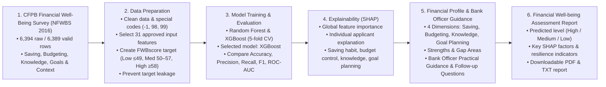
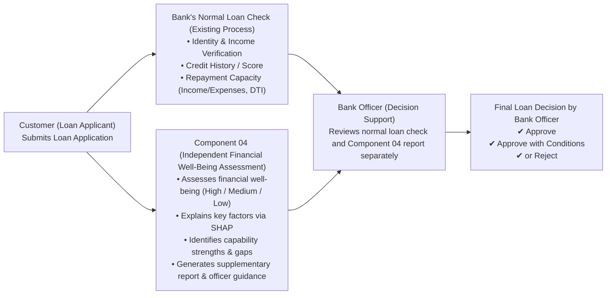

# Component 04 – Explainable Financial Well-being Assessment System for Bank Loan Decision Support

## 1. Component Identity & Dataset Source
**Component 04** is an independent Financial Well-being Assessment System designed to assist a **Bank Officer** during a loan application review. It evaluates a loan applicant's financial well-being (`Low`, `Medium`, `High`), explains the model prediction using **SHAP**, profiles four financial capability dimensions (**Saving, Budgeting, Basic Financial Knowledge, and Financial Goal Planning**), and generates a supplementary assessment report.

- **Dataset**: CFPB National Financial Well-Being Survey (NFWBS) 2016 public-use file (`6,394` raw records; `6,389` valid target records; `31` approved predictor features).
- **Source Page**: https://www.consumerfinance.gov/data-research/financial-well-being-survey-data/
- **Public-Use CSV**: https://www.consumerfinance.gov/documents/5614/NFWBS_PUF_2016_data.csv

Save the CSV as `data/financial_capability/raw/NFWBS_PUF_2016_data.csv` (raw file is gitignored).

To re-run the training and evaluation pipeline from the repository root:

```powershell
python -m backend.src.financial_capability.fc_run_pipeline
```

---

## 2. Diagram A – Independent Component 04 System Workflow



---

## 3. Diagram B – How Component 04 Supports the Bank Loan Scenario



> **Important Governance Notice:** Component 04 does not automatically approve or reject the loan. It provides an additional financial well-being report to help the bank officer make a more informed decision under existing bank policies. Component 04 is completely independent of Components 01, 02, and 03.


